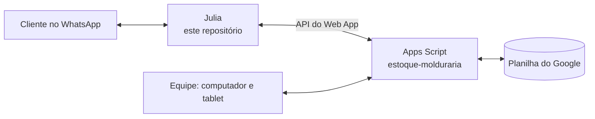

# molduras-bot

A Julia é a atendente virtual da Vera Molduras e Decoração, em Paranavaí (PR). Ela conversa com os clientes no WhatsApp a qualquer hora: entende texto, áudio e foto, mostra molduras, calcula orçamento e passa pra equipe o que precisa de gente.

Ela é feita em Node, conversa pelo WhatsApp com o [Baileys](https://github.com/WhiskeySockets/Baileys) e pensa com o Google Gemini. Roda 24 horas num servidor (VPS) com o pm2.

## Ligação com o controle de estoque

A Julia não guarda catálogo nem preço. Tudo isso fica no [estoque-molduraria](https://github.com/GuilhermeZaros/estoque-molduraria), o sistema de estoque da loja: uma planilha do Google com um Apps Script na frente, usada também pela equipe no computador e no tablet.



Na prática, a conversa entre os dois funciona assim:

- **Cliente pergunta por moldura ou pede orçamento.** A Julia chama a API do estoque (`buscarMolduras`, `listarMateriais`, `consultarProduto`, `calcularOrcamento`). Por isso ela só oferece o que tem e o preço é sempre o mesmo que a loja calcula no balcão. As respostas ficam guardadas 60 segundos pra não pesar na planilha.
- **Quadro ficou pronto na oficina.** A equipe marca no tablet ou no computador. De minuto em minuto a Julia pergunta à API se tem aviso pendente (`oficinaPendentes`), manda a mensagem pro cliente e confirma (`oficinaConfirmarAviso`). Se o envio falhar, ela tenta de novo na próxima volta.

Os dois projetos só se falam pela URL do Web App (`APPS_SCRIPT_URL`). Um não usa código do outro: dá pra atualizar a Julia sem mexer na planilha e vice-versa, desde que a API continue respondendo do mesmo jeito.

## O que a Julia faz

- Atende a qualquer hora, sempre no horário de Brasília.
- Entende áudio e foto do cliente.
- Mostra fotos e modelos das molduras e calcula o orçamento pela regra da loja (moldura pelo perímetro; vidro, chapa e espelho pela área).
- No fim do atendimento manda um resumo pro dono com o que o cliente quer.
- Esquece a conversa 72 horas depois que o atendimento acaba.
- Fica quieta nas conversas que a equipe etiquetou pra atender pessoalmente.
- Tem um modo triagem (`MODO_TRIAGEM=true`) em que só coleta o pedido, sem passar preço.

## O que tem em cada pasta

| Caminho | O que tem |
|---|---|
| `index.js` | Liga no WhatsApp, recebe as mensagens e roda os avisos da oficina |
| `lib/` | A Julia em si: prompt, ferramentas, acesso à API do estoque, mídia, resumo e pausa |
| `scripts/` | `chat.js` conversa com a Julia no terminal; `smoke-tools.js` testa as ferramentas contra a API |
| `test/` | Testes automatizados (`node --test`) |

## Como rodar

```bash
npm install
npm test
npm run chat
npm start
```

`npm run chat` conversa com a Julia no terminal, sem WhatsApp. `npm start` liga o bot de verdade (pede o QR Code na primeira vez). Atenção: a mesma conta do WhatsApp só pode rodar em um lugar por vez.

O `.env` (que nunca vai pro GitHub) precisa de:

```
GEMINI_API_KEY=     chave do Google Gemini
APPS_SCRIPT_URL=    URL /exec do Web App do estoque-molduraria
OFICINA_TOKEN=      senha dos avisos da oficina, gerada pelo menu da planilha
MODO_TRIAGEM=       true para só coletar pedidos (opcional)
```
